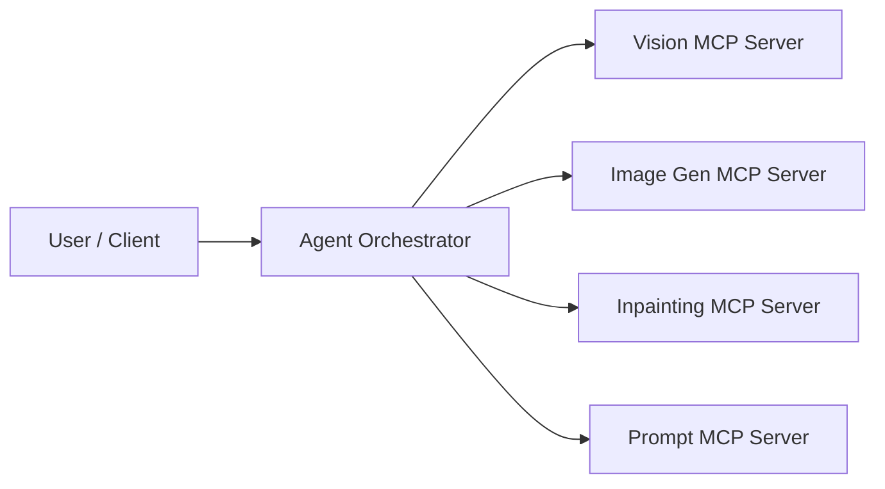
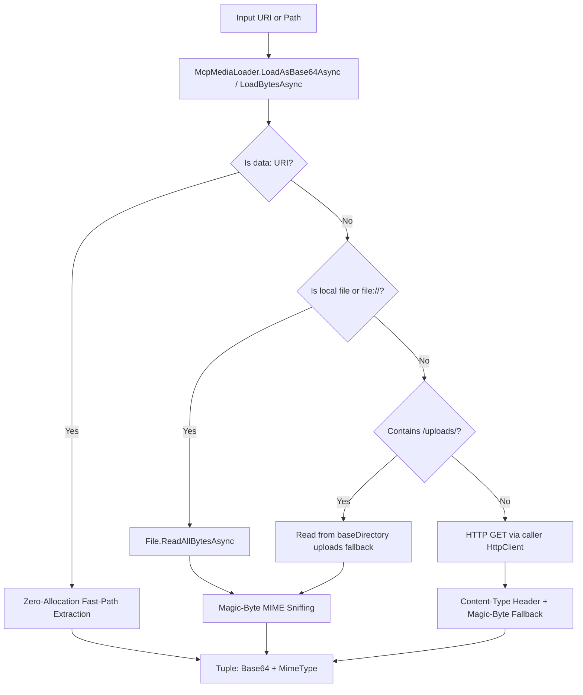

# Multimodal Content & Universal Media Loader Guide

DotnetFastMCP v2.2.0 introduces first-class multimodal capabilities designed for vision, generative AI, image manipulation, and document analysis MCP servers.

This guide provides deep technical details, architectural patterns, API references, and before/after comparisons showing how DotnetFastMCP eliminates duplicated image fetching logic across AI microservices.

---

## 📋 Table of Contents

- [The Multimodal Problem in Agentic Architectures](#the-multimodal-problem-in-agentic-architectures)
- [Architecture & Design Principles](#architecture--design-principles)
- [`McpMediaLoader` Universal Media Resolution](#mcpmedialoader-universal-media-resolution)
  - [Resolution Pipeline](#resolution-pipeline)
  - [Zero-Allocation Data URI Fast Path](#zero-allocation-data-uri-fast-path)
  - [Intelligent MIME Sniffing](#intelligent-mime-sniffing)
- [Expanded `McpContent` Factory Methods](#expanded-mcpcontent-factory-methods)
- [Case Study: Fashion Accessory Pipeline Before & After](#case-study-fashion-accessory-pipeline-before--after)
  - [Before: 160+ Lines of Duplication](#before-160-lines-of-duplication)
  - [After: 4 Single-Line Delegations](#after-4-single-line-delegations)
- [End-to-End Tool Examples](#end-to-end-tool-examples)
- [Production Best Practices & Guardrails](#production-best-practices--guardrails)
- [Testing & Validation](#testing--validation)

---

## The Multimodal Problem in Agentic Architectures

In modern agentic AI systems (such as visual design pipelines, document inspection agents, or e-commerce visual search engines), MCP tools frequently accept or return images and rich binary payloads:



Each server needs to inspect an input image URI that might be:
1. A public HTTP or HTTPS web URL (`https://cdn.example.com/item.jpg`)
2. A local filesystem path (`C:\app\uploads\sample.png` or `/var/data/sample.png`)
3. A `file://` URI protocol (`file:///C:/app/uploads/sample.png`)
4. An in-memory Base64 data URI (`data:image/png;base64,iVBORw0KGgo...`)

Historically, developers copy-pasted a 40-line `FetchImageDataAsync` helper function across every single MCP server project. If a bug was fixed or a new MIME type was supported, each service had to be updated manually.

**DotnetFastMCP 2.2 solves this permanently with `McpMediaLoader` and an expanded `McpContent` factory API.**

---

## Architecture & Design Principles



### Core Design Goals
1. **Zero-Allocation Fast Path**: If the client provides a `data:image/png;base64,...` URI, we extract the base64 substring directly without round-tripping through a `byte[]` heap allocation.
2. **Transparent MIME Sniffing**: Header MIME types can be missing, generic (`application/octet-stream`), or erroneous. We verify magic bytes to ensure upstream LLMs (Gemini, Claude, GPT-4o) receive accurate content types.
3. **Respect Dependency Injection**: Callers can pass an injected `HttpClient` from ASP.NET Core `IHttpClientFactory` to respect socket pooling, resilience policies (Polly), and proxy settings.
4. **Resilient Local Resolution**: Supports absolute paths, relative paths against a configurable `baseDirectory`, and standard `file://` schemas.

---

## `McpMediaLoader` Universal Media Resolution

`McpMediaLoader` is located directly in the `FastMCP` root namespace:

```csharp
using FastMCP;

// Load as Base64 string and MIME type (ideal for LLM inline_data payloads)
var (base64, mimeType) = await McpMediaLoader.LoadAsBase64Async(
    uriOrPath: "https://example.com/photo.jpg",
    httpClient: _httpClient,
    baseDirectory: AppContext.BaseDirectory,
    cancellationToken: ct);

// Load as raw byte array and MIME type (ideal for hashing, resizing, or storage)
var (bytes, mimeType) = await McpMediaLoader.LoadBytesAsync(
    uriOrPath: "C:\\images\\photo.png",
    httpClient: _httpClient,
    cancellationToken: ct);
```

### Resolution Pipeline

| Source Format | Example | Resolution Strategy |
|---------------|---------|---------------------|
| **Data URI** | `data:image/png;base64,iVBORw...` | Direct string extraction of MIME & base64 slice (zero `byte[]` allocation). |
| **Local File** | `C:\data\image.webp` or `/tmp/test.jpg` | Reads bytes asynchronously; runs magic-byte inspection. |
| **File URI** | `file:///C:/data/image.webp` | Parses `Uri.LocalPath`; reads bytes asynchronously. |
| **Uploads Fallback** | `http://localhost:5000/uploads/img1.png` | Checks relative `../FashionPipeline.Api/wwwroot/uploads/` directly to avoid HTTP loopback overhead. |
| **HTTP / HTTPS** | `https://picsum.photos/400/400` | Sends `GET` request using provided or shared `HttpClient`; validates status code; sniffs headers and magic bytes. |

### Intelligent MIME Sniffing

When headers or extensions are missing or ambiguous, `McpMediaLoader` detects formats via leading magic bytes:

| Format | Magic Bytes | Detected MIME Type |
|--------|-------------|--------------------|
| **PNG** | `89 50 4E 47 0D 0A 1A 0A` | `image/png` |
| **JPEG** | `FF D8 FF` | `image/jpeg` |
| **GIF** | `47 49 46 38 37 61` or `47 49 46 38 39 61` | `image/gif` |
| **WebP** | `52 49 46 46` ... `57 45 42 50` | `image/webp` |
| **BMP** | `42 4D` | `image/bmp` |

---

## Expanded `McpContent` Factory Methods

In addition to `McpContent.Text(...)` and `McpContent.ImageFromFileAsync(...)`, DotnetFastMCP 2.2 adds rich factory methods for all standard MCP content types:

```csharp
using FastMCP;

// 1. From Byte Array
McpContent content = McpContent.ImageFromBytes(rawBytes, "image/png");

// 2. From Stream (MemoryStream, FileStream, NetworkStream)
using var stream = File.OpenRead("photo.webp");
McpContent content = await McpContent.ImageFromStreamAsync(stream, "image/webp");

// 3. Directly from URL or File Path
McpContent content = await McpContent.ImageFromUriAsync("https://example.com/cat.jpg", httpClient);

// 4. Strongly-Typed JSON
var order = new { OrderId = 1234, Total = 99.50 };
McpContent content = McpContent.Json(order);

// 5. Embedded MCP Resources
McpContent textRes = McpContent.ResourceText("schema://config", "{\"version\": \"1.0\"}", "application/json");
McpContent blobRes = McpContent.ResourceBlob("schema://weights", modelWeightsBase64, "application/octet-stream");

// 6. Composite Multimodal Response (Multiple items returned together)
var mixed = McpContent.Composite(
    McpContent.Text("Here is the requested analysis and the processed image:"),
    McpContent.ImageFromBytes(processedBytes, "image/png"),
    McpContent.Json(new { confidence = 0.98, detectedObjects = new[] { "lace", "fabric" } })
);
```

---

## Case Study: Fashion Accessory Pipeline Before & After

In the Fashion Accessory AI Pipeline, 4 independent microservices (`VisionMcpServer`, `PromptMcpServer`, `InpaintingMcpServer`, and `ImageMcpServer`) each contained an identical 43-line helper method.

### Before: 160+ Lines of Duplication

```csharp
// Repeated in FeatureExtractionTool.cs, PromptGenerationTool.cs, InpaintingTool.cs, ImageGenerationTool.cs:
private async Task<(string base64, string mimeType)> FetchImageDataAsync(string imageUrl)
{
    if (imageUrl.StartsWith("file://") || File.Exists(imageUrl))
    {
        var localPath = imageUrl.Replace("file:///", "").Replace("file://", "");
        if (File.Exists(localPath))
        {
            var fileBytes = await File.ReadAllBytesAsync(localPath);
            var mime = localPath.EndsWith(".png", StringComparison.OrdinalIgnoreCase) ? "image/png"
                     : localPath.EndsWith(".webp", StringComparison.OrdinalIgnoreCase) ? "image/webp"
                     : "image/jpeg";
            return (Convert.ToBase64String(fileBytes), mime);
        }
    }

    if (imageUrl.Contains("/uploads/"))
    {
        var fileName = imageUrl.Substring(imageUrl.LastIndexOf("/uploads/") + 9);
        var localUploadPath = Path.Combine(Directory.GetCurrentDirectory(), "..", "FashionPipeline.Api", "wwwroot", "uploads", fileName);
        if (File.Exists(localUploadPath))
        {
            var fileBytes = await File.ReadAllBytesAsync(localUploadPath);
            var mime = fileName.EndsWith(".png", StringComparison.OrdinalIgnoreCase) ? "image/png"
                     : fileName.EndsWith(".webp", StringComparison.OrdinalIgnoreCase) ? "image/webp"
                     : "image/jpeg";
            return (Convert.ToBase64String(fileBytes), mime);
        }
    }

    using var request = new HttpRequestMessage(HttpMethod.Get, imageUrl);
    var response = await _httpClient.SendAsync(request);
    if (!response.IsSuccessStatusCode)
    {
        var err = await response.Content.ReadAsStringAsync();
        throw new InvalidOperationException($"Failed to download image from {imageUrl} (Status {response.StatusCode}): {err}");
    }

    var bytes = await response.Content.ReadAsByteArrayAsync();
    var contentType = response.Content.Headers.ContentType?.MediaType ?? "image/jpeg";
    return (Convert.ToBase64String(bytes), contentType);
}
```

### After: 4 Single-Line Delegations

With DotnetFastMCP 2.2:

```csharp
private Task<(string base64, string mimeType)> FetchImageDataAsync(string imageUrl)
    => McpMediaLoader.LoadAsBase64Async(imageUrl, _httpClient);
```

**Results:**
- **160+ lines of duplicated code deleted**
- **Added automatic RFC 2397 `data:` URI support**
- **Added magic-byte sniffing**
- **Centralized error handling and cancellation support**

---

## End-to-End Tool Examples

### Returning an Image from an MCP Tool

```csharp
using FastMCP;
using FastMCP.Attributes;

public class ImageTools
{
    private readonly HttpClient _httpClient;

    public ImageTools(HttpClient httpClient)
    {
        _httpClient = httpClient;
    }

    [McpTool("enhance_image", "Fetches an image, enhances clarity, and returns the modified image")]
    public async Task<McpContent> EnhanceImage(
        [McpDescription("The remote URL, local path, or data URI of the image")] string imageUri,
        CancellationToken ct)
    {
        // 1. Ingest media from any source
        var (bytes, mime) = await McpMediaLoader.LoadBytesAsync(imageUri, _httpClient, cancellationToken: ct);

        // 2. Process image (e.g., resizing, filtering, watermarking)
        byte[] enhancedBytes = ApplyEnhancement(bytes);

        // 3. Return polymorphic McpContent
        return McpContent.ImageFromBytes(enhancedBytes, mime);
    }

    private byte[] ApplyEnhancement(byte[] input) => input; // image processing logic
}
```

### Returning Composite Multi-Part Content

```csharp
[McpTool("generate_visual_report", "Returns both markdown report text and accompanying charts")]
public async Task<McpContent> GenerateVisualReport(string datasetId)
{
    var markdownReport = "# Sales Report\nAnalysis shows a 24% increase...";
    byte[] chartPngBytes = GenerateChartBytes(datasetId);

    return McpContent.Composite(
        McpContent.Text(markdownReport),
        McpContent.ImageFromBytes(chartPngBytes, "image/png"),
        McpContent.Json(new { totalSales = 120000, growthRate = 0.24 })
    );
}
```

---

## Production Best Practices & Guardrails

1. **Size Limits & Memory Guardrails**:
   Always validate base64 or byte length before transmitting payloads to upstream AI models:
   ```csharp
   var (base64, mime) = await McpMediaLoader.LoadAsBase64Async(imageUri, _httpClient);
   if (base64.Length > 5_000_000) // ~3.75 MB image
   {
       throw new InvalidOperationException("Image payload exceeds 5MB limit. Please downsample.");
   }
   ```

2. **Reusing HttpClient**:
   Always pass an injected `HttpClient` from ASP.NET Core `IHttpClientFactory` to benefit from pooled connections and DNS refreshing:
   ```csharp
   builder.Services.AddHttpClient();
   ```

3. **Passing CancellationTokens**:
   Always forward the `CancellationToken` injected by FastMCP to `McpMediaLoader`:
   ```csharp
   [McpTool]
   public async Task<McpContent> Process([McpDescription("URI")] string uri, CancellationToken ct)
   {
       var (bytes, mime) = await McpMediaLoader.LoadBytesAsync(uri, _httpClient, cancellationToken: ct);
       return McpContent.ImageFromBytes(bytes, mime);
   }
   ```

---

## Testing & Validation

DotnetFastMCP includes comprehensive test suites in `tests/FastMCP.Tests/Multimodal/`:
- **`McpMediaLoaderTests.cs`**: Validates Data URIs, local files, `file://` URIs, mock HTTP requests, header sniffing, fallback sniffing, 404/500 errors, cancellation, and corrupt base64.
- **`McpContentTests.cs`**: Validates `ImageFromBytes`, `ImageFromStreamAsync`, `ImageFromUriAsync`, `Json`, `ResourceText`, `ResourceBlob`, and `Composite`.

To run the test suite:
```bash
dotnet test tests/FastMCP.Tests/FastMCP.Tests.csproj
```
All 126 tests run and pass across both `.NET 8 LTS` and `.NET 10 LTS` without any external network dependencies or AI API calls.
